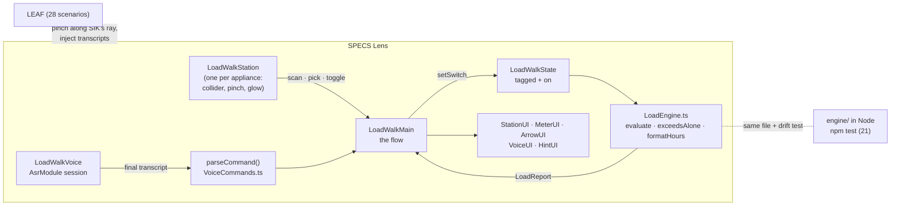
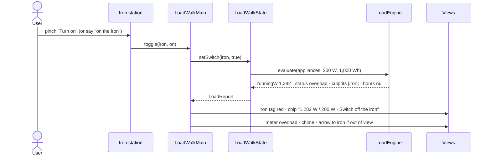

# Load Walk: architecture

A SPECS Lens, built in Lens Studio 5.23.2 from the [design brief](lens/devpost/design-brief.md). It runs in Lens Studio's Interactive Preview, staged in the built-in **Evening Room** environment.

## The idea in one paragraph

You walk your home during a power cut. Pinch an appliance and say what it is, and a tag appears on it with its wattage. It's red if your power station can't run it alone. Switch appliances on and off with a pinch or your voice. A chip by the tag shows the new total and the battery hours left, and a meter floats above the power station. When something pushes the load over the limit, the culprit's own tag turns red, a chime plays, the chip says what to switch off, and an arrow points to it from anywhere in the room. The research behind it is in [`docs/research.md`](docs/research.md).

## System



## The one flow that matters: overload



## Components

| Script | Owns | Must not |
|---|---|---|
| `LoadEngine.ts` | The load maths: capacity, running and peak watts, status, culprits, battery hours | Touch any platform API (it runs in Node too) |
| `VoiceCommands.ts` | Transcript → on / off / ask, including "on the fan" and "off the iron" | Guess: no verb or no known appliance means do nothing |
| `ApplianceCatalog.ts` | Demo data: appliances, picker groups, the 200 W / 1,000 Wh power station | Do maths |
| `LoadWalkState.ts` | Which appliances are tagged and on; the live report | Read the scene |
| `LoadWalkMain.ts` | The flow: scan, tag, toggle by pinch or voice, overload alert, recovery, room placement | Render text or build UI |
| `LoadWalkStation.ts` | One appliance: collider, pinch and hover, glow | Render text or compute load |
| `LoadWalkStationUI.ts` | Scan card, tag with its on/off button, live chip | Decide anything |
| `LoadWalkMeterUI.ts` | The meter above the power station | Decide status |
| `LoadWalkArrowUI.ts` | The arrow to an out-of-view culprit | Decide when to show |
| `LoadWalkVoice.ts` | The Voice switch and speech session: on only while Voice is on, restarts after errors or 45 s of silence | Interpret commands |
| `LoadWalkVoiceUI.ts` | The Voice button and the "heard / answer" panel | Decide anything |
| `LoadWalkHintUI.ts` | The "Scan is a stand-in" note, hidden after the first scan | |
| `LoadWalkTheme.ts` | Colours, number format, text, plate and button helpers | |

## Data model

```ts
type Appliance = { id: string; name: string; runningW: number; surgeFactor: number; on: boolean };
type Inverter  = { ratedW: number } | { kva: number; powerFactor?: number }; // HeroEE 1: { ratedW: 200 }
type Battery   = { wh: number; chemistry: "lithium" | "lead-acid" };       // { wh: 1000, chemistry: "lithium" }

type LoadReport = {
  runningW: number; peakW: number; capacityW: number; headroomW: number; utilization: number;
  status: "idle" | "ok" | "near" | "surge-risk" | "overload";
  culpritIds: string[];          // fewest appliances to switch off, biggest first
  batteryHours: number | null;   // null when nothing is on or when over capacity
};
```

- **Battery hours:** Wh × depth of discharge (lithium 0.85, lead-acid 0.5) × 0.85 conversion ÷ load W.
- **Near:** 80% of capacity or more.
- **Surge:** only the single largest motor start counts, because motors rarely start together.

## Decisions

- **One maths file, two runtimes.** `engine/LoadEngine.ts` has no imports beyond types, so Node tests it and the Lens runs the identical copy. `npm run sync:lens` copies it, and a test fails if the copies differ.
- **Pinch and voice share one path.** Both call `setSwitch(id, on)`. On and off set the state rather than flipping it, so a repeated voice command is harmless.
- **The scan is an honest stand-in.** The preview can't recognise real objects, so you pinch, then pick from a card of 3 or 4 options. A note on screen says so.
- **Buttons outrank appliance bodies, and act only on a pinch that began on them.** SIK sends a pinch to the nearest interactable, and a card opening under the hand mid-pinch had been taking the release as a pick.
- **Bright text, light plates, no dark UI.** The display is additive, so black is transparent. Dark room meshes also vanished in the preview, which is why the demo uses Lens Studio's Evening Room environment instead of our own room.
- **Voice is off by default** and acts only on final transcripts. The speech module has no language setting and no "ended" event, so the Lens restarts the session itself.

## Out of scope

- Real camera recognition of appliances or labels (on glasses only).
- Saving a household's appliances between sessions.
- Multi-user sessions.
- An AI label reader: it was considered and not built.

## Stack

Lens Studio 5.23.2 · TypeScript · Spectacles Interaction Kit · Spectacles UI Kit · Snap ASR Module · LEAF · generated GLB models and a synthesised chime. Built by CLAD through the Lens Studio MCP, from a brief written with the Devpost Learn `plan-lens` skill pack.
