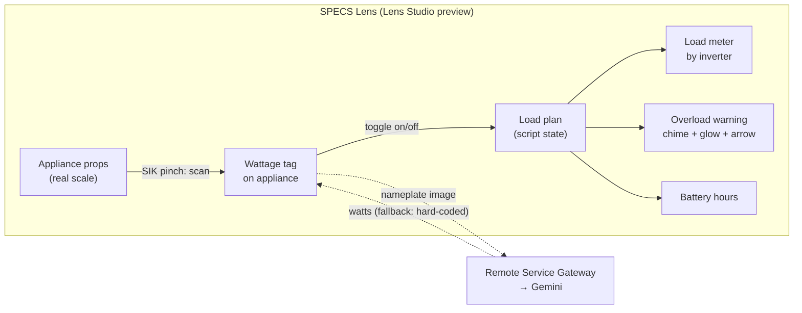

# Load Walk: architecture

> Draft. The design sections get filled in from `devpost/design-brief.md` once it's approved.

## Pitch

**Look around your house, see what your inverter can carry.** In a power cut you walk your home in SPECS, pinch each appliance to tag its wattage, and switch them on or off in a plan. A meter by the inverter shows live load against capacity, warns before startup surge trips it, and tells you how many hours the battery will last. Today the alternative is typing appliances into a web calculator. See `docs/research.md` for the evidence and crowding check.

## Problem and capability map

See `docs/research.md` (problem, removal test, draft capability map). The final map is set after the brief.

## System overview



## Components

| Component | Role |
|---|---|
| Appliance props | Stand-ins for the real room, at real scale. |
| Scan interaction | SIK pinch on an appliance; stands in for camera recognition. |
| Nameplate reader | Optional RSG → Gemini call on a bundled nameplate image; hard-coded fallback. |
| Load plan | Script state: which appliances are on, running and surge watts. |
| Meter, warning, hours | UI anchored by the inverter; overload chime and arrow to the culprit. |
| LEAF tests | One scenario per done criterion. |

## Data model

```ts
type Appliance = { id: string; name: string; runningW: number; surgeFactor: number; on: boolean };
type Inverter = { kva: number; usableW: number };          // usableW = kva * 0.8
type Battery  = { wh: number; dod: number };              // lead-acid 0.5, lithium 0.85
// hours = battery.wh * battery.dod * 0.85 / sum(on.runningW)
// overload when sum(on.runningW) + max(on.surge extra) > inverter.usableW
```

## Key flows

_From the brief._

## Stack

Lens Studio (version per the hackathon quick start), TypeScript, Spectacles Interaction Kit, UI Kit, Remote Service Gateway, LEAF. Built by CLAD through the Lens Studio MCP.

## Out of scope

- Live camera recognition (preview can't show it).
- Saving plans between sessions.
- Multi-user / connected sessions.

## Milestones

_Set after the brief. M1 = the thinnest end-to-end slice: scan one appliance, toggle it, meter moves._
