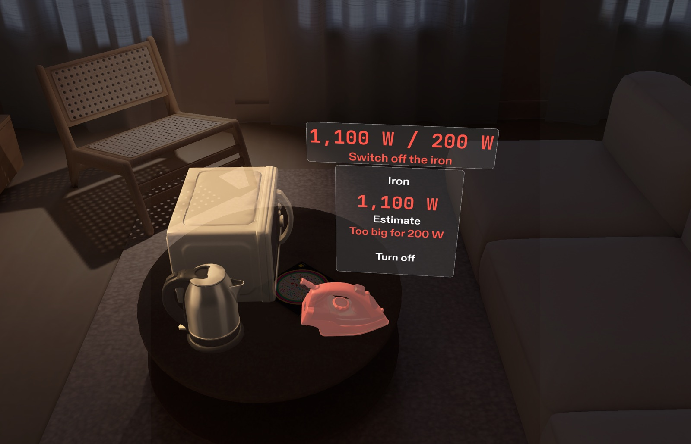
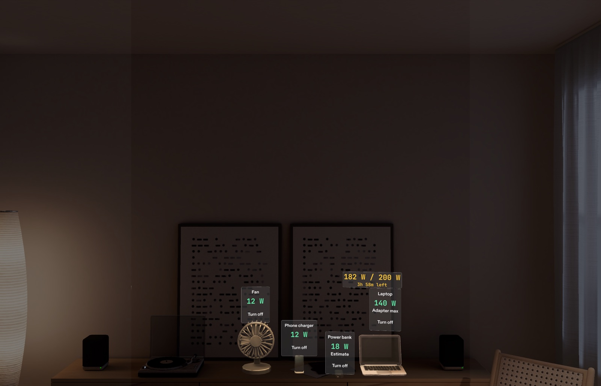
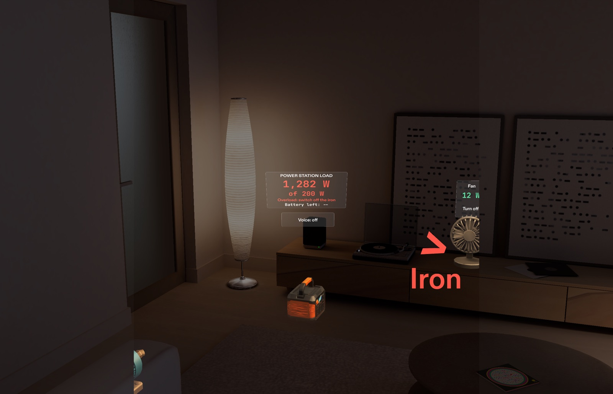
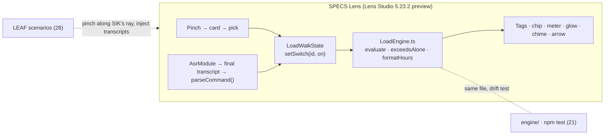

# Load Walk



   

### Look around your house, see what your inverter can carry.

Load Walk is a SPECS Lens for households that live with power cuts and run on a small inverter or power station. Pinch an appliance to tag it with its wattage, switch things on and off with a pinch or your voice, and the answer sits on the appliances themselves: the running total, whether it fits, how many hours of battery are left, and which appliance to switch off before the unit trips.

**[Watch the demo](https://youtu.be/JQoKEzufpuk)** · **[Judge it in 90 seconds](#judge-it-in-90-seconds)** · **[Design brief](lens/devpost/design-brief.md)** · **[Architecture](ARCHITECTURE.md)** · **[Run it locally](#run-it-locally)**

## Demo

[](https://youtu.be/JQoKEzufpuk)

2 minutes 54 seconds, recorded from Lens Studio's preview. Nothing is sped up; the cuts only remove pauses. The scan is a stand-in (see [What's real vs simplified](#whats-real-vs-simplified)).

| Desk at 182 of 200 W | Iron overload | Meter by the power station |
|---|---|---|
|  |  |  |

## Judge it in 90 seconds

| Check | How | Result |
|---|---|---|
| The load maths is right | `npm test` | 21/21 pass |
| The demo story's numbers | `npm run scenario` → [`docs/evidence/engine-scenario.txt`](docs/evidence/engine-scenario.txt) | 182 W / 200 W, 3h 58m; iron → 1,282 W, overload, "switch off: iron" |
| The Lens meets its done criteria | LEAF in Lens Studio, see [`docs/evidence/leaf-results.md`](docs/evidence/leaf-results.md) | 28 scenarios; all 6 done criteria pass on every run (28/28 and 27/28 back to back, see note below) |
| What it looks like | [`docs/evidence/screenshots/`](docs/evidence/screenshots/) | Final captures from the preview, plus the first build for comparison |

**LEAF note, honestly:** two full runs back to back gave 28/28 and 27/28. The one failure was `extra-ik-reach-fan`, an extra test that drives a full-arm avatar to pinch the fan. It sometimes fails on a cold start when the avatar's pinch never registers; it always passes when re-run, and one failing trace averaged 98 ms per editor frame against about 22 ms in passing runs. It isn't one of the six done criteria, and every done-criterion scenario passed in both runs. Details in [`docs/evidence/leaf-results.md`](docs/evidence/leaf-results.md).

The numbers you see in the Lens come from one formula, shared by the tests and the Lens (a test fails if the two copies ever differ):

```
battery hours = 1,000 Wh × 0.85 usable (LiFePO4) × 0.85 conversion ÷ load W
182 W → 3h 58m      42 W → 17h 12m      24 W → 30h 6m
```

## Contents

[The problem](#the-problem) · [What it does](#what-it-does) · [Why glasses](#why-glasses) · [Architecture](#architecture) · [The hard problems](#the-hard-problems) · [What's real vs simplified](#whats-real-vs-simplified) · [Design process](#design-process) · [Run it locally](#run-it-locally) · [Disclosure](#disclosure)

## The problem

One night the power went out and I had to iron a shirt for work early the next morning. I thought my inverter could take the iron, so I plugged it in and tried. It tripped, and I had no idea why.

The reason is simple once you can see it:

My power station is a Home Power Dock HeroEE 1: **200 W output, 1 kWh lithium battery** (that's what the label on the box says). My desk alone (fan, phone charger, power bank, laptop) takes 182 W of it. My pressing iron wants about 1,100 W, so it trips the unit on its own the second it heats up.

Today the way to find out what you can run is a web calculator: type each appliance in, add it up, and hope you remembered the right number. Nigerian installer guides tell people to just buy double what they think they need. Nobody is standing at the calculator when the power goes; they're standing at the freezer with a torch.

## What it does

| Capability | What you do | What you see | Built with |
|---|---|---|---|
| Scan (stand-in) | Pinch an appliance, pick what it is from a short card | A tag on the appliance: name, wattage, "Estimate" if unlabelled, "Too big for 200 W" if it can't run alone | SIK interactables, UI Kit, `exceedsAlone()` |
| Switch | Pinch Turn on / Turn off on the tag | A chip by the tag: "42 W / 200 W · 17h 12m", fading after a few seconds | `evaluate()`, `formatHours()` |
| Meter | Walk to the power station on the floor | A meter 70 cm above it: load, limit, status, battery left | Same engine, mint / amber / red states |
| Overload | Switch on something too big | The chip and meter turn red, the culprit glows, a chime plays, an arrow points to it if it's out of view; the meter says what to switch off | `evaluate()` culprits, spatial audio |
| Voice | Turn Voice on, say "on the fan", "off the iron", "can I run the freezer?" | The same result as the pinch; "can I run" answers on the tag and switches nothing | Snap `AsrModule` + `parseCommand()` |
| Fix a mistake | Pinch a tag's name | The card reopens and a new pick replaces the tag | |

## Why glasses

- **It shares your view.** You look at the appliance you're deciding about. (In the preview the recognition is a stand-in pick; on glasses the camera would read it.)
- **It draws in the world.** The wattage sits on the fan, the meter sits on the power station, the warning glows on the iron, not in a list on a screen.
- **It leaves your body free.** In the dark, holding a torch, you say "off the iron" or pinch once. No phone, no typing.

A phone version could add numbers up. It can't keep the answer on the things themselves while your hands are busy.

## Architecture



Pinch and voice both call the same `setSwitch()`, so they can't disagree. On and off set the state rather than flipping it, so a repeated voice command is harmless. More in [ARCHITECTURE.md](ARCHITECTURE.md).

| Path | What it is |
|---|---|
| `engine/LoadEngine.ts` | The load maths. No platform APIs, so the Lens and Node run the same file |
| `engine/VoiceCommands.ts` | Transcript → on / off / ask. Understands "on the fan" and "off the light" as well as "turn on" |
| `lens/` | The Lens Studio project (scene, scripts, generated models, LEAF scenarios) |
| `lens/devpost/design-brief.md` | The brief from the Devpost Learn `plan-lens` interview |
| `docs/research.md` | The problem check done before any code |
| `docs/build-log.md` | Every surprise, dead end and fix, in order |
| `docs/voice-spike.md` | The test that proved speech works in the preview |
| `docs/evidence/` | LEAF results, engine output, screenshots |

## The hard problems

**The fan that kept becoming a power bank.** Hand-testing, I'd pinch the fan, pick "Fan", and get a tag reading "Power bank". It looked like the card's buttons were wired to the wrong options. They weren't: the phone charger's card opened right over the fan, its buttons sat 4 cm inside the fan's invisible pinch box, and SIK sends a pinch to the nearest box. So "Fan" on the charger's card hit the fan, which opened the fan's own card. The same bug made voice look broken ("Fan is not scanned") because the fan's spot was registered as something else. Fix: UI buttons now outrank appliance bodies, cards open in front of their own appliance, options keep a fixed order, and any tag can be re-picked. Guarded by `extra-desk-cards-by-label`, which opens every desk card three times and picks by the label on screen.

**The login that blocked the whole platform.** Lens Studio 5.24.1's sign-in failed in every browser. The SPECS team's workaround was to downgrade to 5.23.2, and a project saved in 5.24 warns it may be unstable in 5.23, so the project was rebuilt from a fresh 5.23.2 Base Template and the brief and engine moved in. Speech recognition also returned 401 until signed in.

**Readable on an additive display.** The first build was correct and unreadable: grey boxes, a grey void, 2 cm text. Three design rounds later: generated models, a warm room, wattage as the biggest line on each tag (~4 cm digits, measured from rendered pixels), unlit text, plates that fit their content. Compare [`first-build.png`](docs/evidence/screenshots/first-build.jpg) with [`desk-182w.png`](docs/evidence/screenshots/desk-182w.jpg).

**Voice with no language setting.** Snap's speech module guesses the language; a noisy room once came back in Russian. It also has no "ended" event, so a dropped stream is silent. The Lens acts only on final transcripts, restarts the session after 45 s of silence or after an error, and keeps voice off by default behind a toggle. The spike that proved it works in the preview is in [`docs/voice-spike.md`](docs/voice-spike.md).

## What's real vs simplified

| Capability | How it's backed | Status |
|---|---|---|
| Load, surge, battery maths | `LoadEngine.ts`, 21 unit tests, same file in the Lens | Real |
| Tags, toggles, meter, overload warning, chime, arrow | Lens scripts, LEAF scenarios | Real (in the preview) |
| Voice commands | Snap AsrModule in the preview, tested with my voice | Real, needs internet and a signed-in Lens Studio; tested with one speaker |
| Appliance recognition | Pinch and pick from a card | **Stand-in**: the preview can't run camera recognition |
| Wattages | Fan 12 W (its label), power station 200 W / 1 kWh (its label), laptop 140 W (adapter maximum), phone charger 12 W, power bank 18 W and iron 1,100 W (estimates) | Partly estimated, marked on the tags |
| Comfort, hand tracking, real-world placement | Not testable without glasses | Feel unproven |
| Saving tags between sessions | | Not built |

## Design process

1. **Research and a problem gate** before any code ([`docs/research.md`](docs/research.md)): who has the problem, what it costs, what exists, why it needs glasses.
2. **The `plan-lens` interview** from the Devpost Learn skill pack produced [the design brief](lens/devpost/design-brief.md): the one spatial moment, placement, the scan stand-in, and five checkable done criteria with real numbers from my power station's label. Voice was added later as a sixth.
3. **CLAD built the Lens** in Lens Studio through the Lens Studio MCP, then four design rounds driven by preview captures and my own walk-throughs.
4. **LEAF** checks every done criterion (28 scenarios in total). The engine has its own tests so the maths can be trusted outside Lens Studio.

Everything that surprised us is in [`docs/build-log.md`](docs/build-log.md).

## Run it locally

1. Install **Lens Studio 5.23.2** (macOS arm or Windows) and sign in.
2. Open `lens/lens.esproj`. Open the Preview panel (Window → Default Layout) with the device set to SPECS 27 and the environment set to **Evening Room** (the dropdown at the top of the Preview panel).
3. Walk with WASD or a trackpad swipe, look with right-drag, click to pinch. Scan the fan, phone charger, power bank and laptop, then the iron.
4. Voice (optional): turn on the preview's microphone and the Lens's Voice toggle, then speak and pause.
5. Engine tests: `npm test` (Node 22.18+, no dependencies). Demo numbers: `npm run scenario`.

No API keys are needed.

## Disclosure

Built for **Learn AR with SPECS** (Devpost), first commit 21 Oct 2026. Planned with the Devpost Learn `plan-lens` skill pack; built with Snap's CLAD agents, Spectacles Interaction Kit, UI Kit and LEAF. 3D models were generated by CLAD. Numbers use JetBrains Mono (SIL Open Font License).

Voice sends audio to Snap's speech service while the Voice toggle is on. Wattages are typical values or estimates; check your own appliance labels and your installer before buying equipment.
